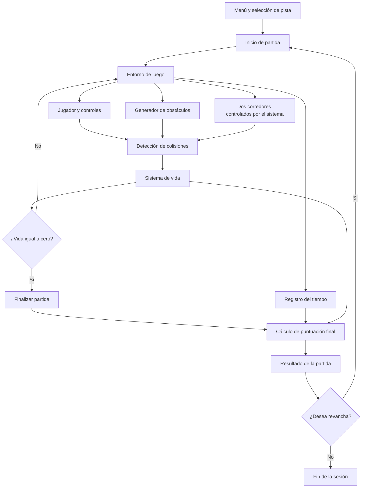

# DOCUMENTACIÓN DEL PROYECTO
# CORRE SIN MORIR

**Proyecto:** Corre sin morir  
**Tipo de proyecto:** Videojuego móvil  
**Motor de desarrollo:** Unity  
**Lenguaje de programación:** C#  
**Plataforma:** Android  
**Estado:** En desarrollo  
**Metodología:** Modelo de desarrollo en espiral  

---

# 1. Introducción

El desarrollo de videojuegos requiere aplicar diferentes principios de ingeniería de software para planificar, diseñar, implementar y probar las funcionalidades que conforman el producto. Este proceso permite organizar el trabajo, establecer requisitos y verificar que el sistema cumpla con los objetivos propuestos.

El presente proyecto consiste en el desarrollo de *Corre sin morir*, un videojuego móvil creado utilizando Unity como motor de desarrollo y C# como lenguaje de programación, dirigido a dispositivos con sistema operativo Android.

El videojuego se basa en una dinámica de conducción en la que el jugador debe esquivar obstáculos y competir contra dos corredores controlados por el sistema. Durante la partida, el jugador contará con un sistema de vida que disminuirá según la intensidad de las colisiones. Además, se implementará un sistema de puntuación que tendrá en cuenta la ventaja de tiempo y la vida restante al finalizar el recorrido.

Para el desarrollo se utilizará el modelo en espiral, debido a que permite implementar funcionalidades progresivamente, realizar pruebas después de incorporar cambios, identificar posibles errores y efectuar mejoras orientadas a ofrecer una experiencia satisfactoria al usuario.

En este documento se presenta la descripción del proyecto, su alcance, los objetivos, la metodología seleccionada, los requisitos del software, el diseño y la arquitectura, el proceso de implementación y las pruebas propuestas para verificar su funcionamiento.

# 2. Descripción del proyecto

*Corre sin morir* es un videojuego móvil en desarrollo, creado utilizando Unity como motor de desarrollo y C# como lenguaje de programación, dirigido a dispositivos con sistema operativo Android. El juego se basa en una dinámica de conducción en la que el jugador debe esquivar los obstáculos que encuentra durante el recorrido, mientras compite contra otros dos corredores controlados por el sistema.

La mecánica principal consiste en conducir y evitar los obstáculos presentes en el camino, procurando avanzar durante el recorrido sin chocar. A diferencia de un videojuego de carreras tradicional, el enfoque principal no está únicamente en la velocidad, sino también en la capacidad del jugador para reaccionar y esquivar los obstáculos mientras compite con los oponentes controlados por el juego.

El desarrollo del videojuego se realiza de manera progresiva, implementando y ajustando sus funcionalidades a medida que avanza el proyecto. Para ello, se emplea el modelo de desarrollo en espiral, que permite realizar pruebas después de incorporar cambios, identificar posibles errores y efectuar mejoras orientadas a ofrecer una experiencia satisfactoria al usuario.

El proyecto busca aplicar los conocimientos de ingeniería de software en el diseño, desarrollo y evaluación de un videojuego móvil, teniendo en cuenta sus mecánicas de conducción, la interacción del jugador con el entorno y las pruebas necesarias para verificar su funcionamiento.

# 3. Alcance del sistema

El proyecto *Corre sin morir* consiste en el desarrollo de un videojuego móvil para dispositivos Android, utilizando Unity como motor de desarrollo y C# como lenguaje de programación. El juego se basa en una dinámica de conducción en la que el jugador debe avanzar por una pista, esquivar obstáculos y competir contra dos corredores controlados por el sistema. El objetivo es completar el recorrido, evitar perder toda la vida y obtener una puntuación de acuerdo con el desempeño durante la partida.

## 3.1. Funcionalidades incluidas

El sistema contará con las siguientes funcionalidades:

- **Selección de pista:** el jugador podrá elegir entre dos pistas disponibles o seleccionar la opción aleatoria para que el juego escoja una de ellas.
- **Generación aleatoria de obstáculos:** la cantidad y la ubicación de los obstáculos variarán aleatoriamente durante el recorrido, permitiendo que las partidas presenten diferencias.
- **Sistema de vida:** el jugador comenzará cada partida con 1.000 puntos de vida. Esta cantidad disminuirá cuando se produzcan colisiones con obstáculos o corredores.
- **Daño por colisiones:** la cantidad de vida perdida dependerá del tipo de objeto con el que se produzca la colisión y de la intensidad del impacto.

| Tipo de colisión | Intensidad | Daño |
|---|---|---:|
| Obstáculo | Leve | 20 puntos |
| Obstáculo | Fuerte | 100 puntos |
| Corredor | Leve | 10 puntos |
| Corredor | Fuerte | 70 puntos |

- **Competidores controlados por el sistema:** participarán dos corredores controlados por el juego, que competirán por avanzar durante el recorrido. Estos no chocarán contra el jugador; sin embargo, si el jugador choca contra ellos, recibirá daño.
- **Finalización de la partida:** cuando la vida del jugador llegue a cero, la partida terminará inmediatamente.
- **Opción de revancha:** al finalizar la partida, el jugador tendrá la opción de volver a jugar en la misma pista.
- **Registro del tiempo:** el sistema tendrá en cuenta el tiempo de la partida y la ventaja temporal del jugador frente al corredor que ocupe el puesto inmediatamente siguiente.
- **Sistema de puntuación:** la puntuación final estará compuesta por los puntos obtenidos por la ventaja de tiempo y los puntos correspondientes a la vida restante.
- **Cálculo de puntos por tiempo:** se otorgarán 10 puntos por cada intervalo de 10 milésimas de segundo de ventaja frente al corredor que ocupe el puesto inmediatamente siguiente.
- **Cálculo de puntos por vida restante:** por cada 10 puntos de vida conservados al finalizar la partida, el jugador recibirá 1 punto en el marcador. Como la vida inicial es de 1.000 puntos, se podrán obtener hasta 100 puntos por este concepto.

La fórmula general de puntuación será:

**Puntuación total = puntos por ventaja de tiempo + puntos por vida restante.**

Para calcular los puntos por vida restante se utilizará la siguiente fórmula:

**Puntos por vida = parte entera de (vida restante ÷ 10).**

Por ejemplo, si el jugador termina con 857 puntos de vida y obtiene 120 puntos por ventaja de tiempo, recibirá 85 puntos por vida restante, para una puntuación final de 205 puntos.

## 3.2. Limitaciones del sistema

El alcance inicial del videojuego tendrá las siguientes limitaciones:

- El juego contará únicamente con dos pistas; no se contempla la incorporación de pistas adicionales dentro del alcance actual.
- La cantidad y la ubicación de los obstáculos serán aleatorias, pero el proyecto no establece que los tipos de obstáculos deban seleccionarse aleatoriamente.
- El jugador comenzará cada partida con 1.000 puntos de vida y perderá vida según la intensidad de las colisiones definidas.
- Los dos corredores serán controlados por el sistema y no podrán chocar contra el jugador.
- La selección aleatoria de pista se limitará a las dos pistas disponibles.
- La revancha permitirá repetir la partida en la misma pista.
- El videojuego estará dirigido a dispositivos Android. No se contempla, por el momento, su publicación para iOS, computadores o navegadores web.
- No se incluyen funcionalidades de multijugador en línea, compras dentro del juego ni sistemas adicionales de progresión que no hayan sido definidos para el proyecto.

## 3.3. Aspectos por definir durante el desarrollo

Aunque las funcionalidades principales y las reglas de puntuación están establecidas, algunos detalles técnicos deberán precisarse durante el diseño y la implementación:

- Los criterios exactos para determinar si una colisión es leve o fuerte.
- El comportamiento y la velocidad de los dos corredores controlados por el sistema.
- El mecanismo para medir la ventaja de tiempo frente al corredor que ocupa el puesto inmediatamente siguiente.
- La forma de gestionar las diferencias de tiempo y convertirlas en intervalos de 10 milésimas de segundo para calcular los puntos.
- La interfaz mediante la cual se mostrarán la vida restante, el tiempo, la posición y la puntuación.
- La forma de presentar el resultado final y la opción de revancha.

Estos aspectos se definirán y probarán progresivamente durante el desarrollo, aplicando el modelo en espiral para detectar errores, evaluar los cambios y mejorar el funcionamiento del videojuego.

# 4. Objetivos

## 4.1. Objetivo general

Desarrollar un videojuego móvil llamado *Corre sin morir*, utilizando Unity como motor de desarrollo y C# como lenguaje de programación, dirigido a dispositivos Android, en el que el jugador pueda conducir, esquivar obstáculos y competir contra dos corredores controlados por el sistema, incorporando un sistema de vida y puntuación que permita evaluar su desempeño, mediante el modelo de desarrollo en espiral para mejorar progresivamente el funcionamiento del juego y la experiencia del usuario.

## 4.2. Objetivos específicos

- Identificar y definir los requisitos funcionales y no funcionales del videojuego, teniendo en cuenta las mecánicas de conducción, los obstáculos, los corredores y el sistema de puntuación.
- Diseñar e implementar las mecánicas de conducción y evasión de obstáculos, incluyendo la selección entre las dos pistas disponibles y la generación aleatoria de obstáculos.
- Desarrollar un sistema de vida que permita registrar el daño recibido por colisiones con obstáculos y corredores, de acuerdo con la intensidad del impacto.
- Incorporar dos corredores controlados por el sistema, con los que el jugador pueda competir durante el recorrido.
- Implementar un sistema de puntuación que considere la ventaja de tiempo frente al corredor siguiente y la vida restante al finalizar la partida.
- Aplicar el modelo de desarrollo en espiral mediante ciclos de planificación, análisis, implementación y pruebas, para identificar riesgos y realizar ajustes durante el desarrollo.
- Ejecutar pruebas para verificar el funcionamiento de las mecánicas, detectar errores y evaluar los cambios implementados.
- Mejorar progresivamente la estabilidad, la jugabilidad y la experiencia del usuario a partir de los resultados obtenidos durante las pruebas.

# 5. Metodología de desarrollo en espiral

## 5.1. Modelo de desarrollo seleccionado

Para el desarrollo del videojuego *Corre sin morir* se seleccionó el modelo de desarrollo en espiral, debido a que permite construir el software de manera progresiva, realizando ciclos de planificación, análisis de riesgos, desarrollo y pruebas.

Esta metodología resulta adecuada para el proyecto porque las mecánicas de conducción, la generación de obstáculos, el sistema de vida y el marcador pueden necesitar ajustes durante la implementación. Mediante ciclos sucesivos, es posible identificar errores, evaluar los cambios realizados y mejorar el funcionamiento del videojuego.

## 5.2. Aplicación del modelo en espiral

El modelo se aplicará mediante las siguientes actividades:

1. **Planificación:** se identificarán las funcionalidades que se van a desarrollar o mejorar en cada ciclo, teniendo en cuenta los requisitos del videojuego.
2. **Análisis de riesgos:** se identificarán posibles problemas relacionados con las mecánicas de conducción, las colisiones, la generación aleatoria de obstáculos, el sistema de vida y el cálculo de la puntuación.
3. **Desarrollo e implementación:** se programarán las funcionalidades definidas utilizando Unity como motor de desarrollo y C# como lenguaje de programación.
4. **Pruebas y evaluación:** se ejecutará el videojuego para comprobar el funcionamiento de las funcionalidades implementadas, detectar errores y verificar que los resultados correspondan con los requisitos establecidos.
5. **Retroalimentación y nuevo ciclo:** se analizarán los resultados de las pruebas y se determinarán los ajustes necesarios para continuar con el siguiente ciclo de desarrollo.

Este proceso se repetirá durante el proyecto hasta alcanzar un funcionamiento satisfactorio de las funcionalidades previstas.

## 5.3. Beneficios de la metodología

La aplicación del modelo de desarrollo en espiral ofrece los siguientes beneficios para el proyecto:

- Permite realizar mejoras progresivas en las funcionalidades del videojuego.
- Facilita la detección temprana de errores mediante pruebas continuas.
- Ayuda a identificar y reducir riesgos durante el desarrollo.
- Permite evaluar los cambios antes de continuar con nuevas funcionalidades.
- Favorece la mejora de la jugabilidad y de la experiencia del usuario.

# 6. Requisitos del software

Los requisitos del software describen las funcionalidades y condiciones que debe cumplir el videojuego *Corre sin morir*. Se dividen en requisitos funcionales, relacionados con las acciones que puede realizar el sistema, y requisitos no funcionales, que establecen las condiciones de calidad y funcionamiento del videojuego.

## 6.1. Requisitos funcionales

Los requisitos funcionales definen las características y acciones que deberá realizar el videojuego.

| Código | Requisito funcional |
|---|---|
| RF-01 | El sistema deberá permitir al jugador seleccionar una de las dos pistas disponibles o elegir la opción aleatoria. |
| RF-02 | El sistema deberá generar obstáculos en cantidades y ubicaciones aleatorias durante el recorrido. |
| RF-03 | El sistema deberá iniciar cada partida con 1.000 puntos de vida para el jugador. |
| RF-04 | El sistema deberá detectar las colisiones del jugador contra obstáculos y corredores. |
| RF-05 | El sistema deberá descontar 20 puntos de vida por una colisión leve contra un obstáculo y 100 puntos por una colisión fuerte. |
| RF-06 | El sistema deberá descontar 10 puntos de vida por una colisión leve contra un corredor y 70 puntos por una colisión fuerte. |
| RF-07 | El sistema deberá incorporar dos corredores controlados por el juego, que competirán por avanzar durante el recorrido. |
| RF-08 | Los corredores controlados por el sistema no deberán chocar contra el jugador; si el jugador choca contra ellos, deberá recibir el daño correspondiente. |
| RF-09 | El sistema deberá finalizar inmediatamente la partida cuando la vida del jugador llegue a cero. |
| RF-10 | Al finalizar la partida, el sistema deberá ofrecer la posibilidad de iniciar una revancha en la misma pista. |
| RF-11 | El sistema deberá registrar el tiempo de la partida y determinar la ventaja temporal del jugador frente al corredor que ocupe el puesto inmediatamente siguiente. |
| RF-12 | El sistema deberá otorgar 10 puntos por cada intervalo de 10 milésimas de segundo de ventaja frente al corredor que ocupe el puesto inmediatamente siguiente. |
| RF-13 | El sistema deberá otorgar 1 punto por cada 10 puntos de vida restantes al finalizar la partida, tomando únicamente la parte entera del resultado. |
| RF-14 | El sistema deberá calcular la puntuación final sumando los puntos por ventaja de tiempo y los puntos por vida restante. |

## 6.2. Requisitos no funcionales

Los requisitos no funcionales establecen condiciones de calidad que deberá cumplir el videojuego durante su desarrollo y ejecución.

| Código | Requisito no funcional |
|---|---|
| RNF-01 | **Compatibilidad:** el videojuego deberá estar dirigido a dispositivos móviles con sistema operativo Android compatibles con los requisitos técnicos definidos para el proyecto. |
| RNF-02 | **Usabilidad:** los controles y las opciones principales deberán ser comprensibles y fáciles de utilizar para el jugador. |
| RNF-03 | **Rendimiento:** el videojuego deberá mantener una ejecución fluida durante el recorrido, la generación de obstáculos y las colisiones. |
| RNF-04 | **Confiabilidad:** las mecánicas de vida, daño, finalización de partida y puntuación deberán producir resultados coherentes con las reglas establecidas. |
| RNF-05 | **Mantenibilidad:** el desarrollo deberá permitir corregir errores y realizar ajustes en las funcionalidades sin necesidad de reconstruir completamente el videojuego. |
| RNF-06 | **Calidad:** las funcionalidades implementadas deberán someterse a pruebas durante los ciclos del modelo de desarrollo en espiral para identificar errores y realizar mejoras. |

## 6.3. Verificación de los requisitos

La verificación de los requisitos se realizará mediante pruebas durante el desarrollo del videojuego. Se comprobará que las pistas puedan seleccionarse correctamente, que los obstáculos aparezcan de forma aleatoria, que las colisiones descuenten la cantidad de vida correspondiente y que la partida finalice al llegar a cero puntos de vida.

También se verificará el funcionamiento de la revancha y la exactitud de la puntuación obtenida por tiempo y vida restante. Los resultados permitirán identificar errores y establecer ajustes en los siguientes ciclos de desarrollo.

# 7. Diseño y arquitectura

El diseño y la arquitectura de *Corre sin morir* establecen la organización general del videojuego y la relación entre sus componentes. La estructura propuesta contempla el control del jugador, las pistas, los obstáculos, los corredores, el sistema de vida y el cálculo de la puntuación.

Unity se utilizará como motor de desarrollo para construir el entorno del videojuego, gestionar los objetos y ejecutar las mecánicas programadas en C#.

## 7.1. Componentes principales del sistema

El videojuego estará organizado en los siguientes componentes:

- **Jugador:** representa al usuario dentro del juego. Permite controlar el vehículo, avanzar por la pista y realizar movimientos para esquivar obstáculos.
- **Pistas:** corresponden a los dos recorridos disponibles. El jugador podrá seleccionar una pista o utilizar la opción de selección aleatoria.
- **Generador de obstáculos:** se encargará de determinar aleatoriamente la cantidad y la ubicación de los obstáculos durante el recorrido.
- **Corredores controlados por el sistema:** representan a los dos competidores que avanzan durante la partida y compiten con el jugador.
- **Sistema de colisiones:** detectará los impactos del jugador contra obstáculos y corredores, y determinará el daño correspondiente según la intensidad de la colisión.
- **Sistema de vida:** administrará los 1.000 puntos de vida iniciales y actualizará la cantidad restante después de cada impacto.
- **Sistema de tiempo y puntuación:** registrará el tiempo de la partida y calculará los puntos por ventaja temporal y vida restante.
- **Control de partida:** gestionará la finalización del juego cuando la vida llegue a cero y permitirá iniciar una revancha en la misma pista.

## 7.2. Arquitectura general

La arquitectura propuesta se basa en la interacción entre los componentes del videojuego. El jugador interactúa con el entorno mediante los controles; los obstáculos y corredores forman parte del recorrido; el sistema de colisiones comunica los impactos al sistema de vida, y el sistema de puntuación utiliza los datos de tiempo y vida restante para calcular el resultado final.

La siguiente representación muestra la relación general entre los componentes:

Esta arquitectura representa la organización lógica propuesta para el videojuego. Su implementación concreta podrá ajustarse según la estructura de escenas, objetos y scripts que se utilicen en Unity.

## 7.3. Diseño de la dinámica de juego

La dinámica general de una partida se desarrollará de la siguiente manera:

1. El jugador selecciona una de las dos pistas o elige la selección aleatoria.
2. El sistema inicia la partida y asigna al jugador 1.000 puntos de vida.
3. El jugador conduce mientras compite contra dos corredores y esquiva los obstáculos que aparecen durante el recorrido.
4. Cuando se produce una colisión, el sistema determina su intensidad y descuenta los puntos de vida correspondientes.
5. Si la vida es mayor que cero, la partida continúa. Si llega a cero, la partida termina inmediatamente.
6. Al finalizar, el sistema calcula la puntuación con base en la ventaja de tiempo y la vida restante.
7. El jugador puede elegir una revancha en la misma pista.

## 7.4. Diseño de la interacción del usuario

La interacción del usuario se centrará en controlar el vehículo, seleccionar la pista y consultar la información relevante de la partida. El diseño deberá facilitar la comprensión de las mecánicas y permitir que el jugador identifique su estado durante el recorrido.

Se consideran los siguientes elementos de interacción:

- **Selección de pista:** opciones para elegir entre las dos pistas o utilizar la selección aleatoria.
- **Controles del vehículo:** mecanismos de entrada para dirigir el vehículo durante el recorrido.
- **Información de la partida:** elementos visuales para consultar la vida restante, el tiempo y la posición o el avance de los competidores.
- **Resultado final:** presentación de la puntuación obtenida y opción para iniciar una revancha en la misma pista.

La distribución visual definitiva de estos elementos se establecerá durante la implementación y podrá mejorarse mediante pruebas de usabilidad.

# 8. Desarrollo e implementación

El desarrollo de *Corre sin morir* se realiza utilizando Unity como motor de desarrollo y C# como lenguaje de programación. El proceso contempla la construcción del entorno del videojuego, la implementación de las mecánicas de conducción, la incorporación de obstáculos y corredores, y el desarrollo de los sistemas de vida, tiempo y puntuación.

La implementación se llevará a cabo de manera progresiva, siguiendo el modelo de desarrollo en espiral. Esto permitirá incorporar funcionalidades, realizar pruebas, identificar errores y efectuar ajustes durante el desarrollo.

## 8.1. Herramientas y tecnologías

Las herramientas y tecnologías definidas para el proyecto son las siguientes:

| Herramienta o tecnología | Uso en el proyecto |
|---|---|
| Unity | Motor utilizado para desarrollar el entorno, gestionar los objetos y construir el videojuego. |
| C# | Lenguaje de programación utilizado para implementar las mecánicas y la lógica del juego. |
| Android | Plataforma móvil a la que está dirigido el videojuego. |

## 8.2. Implementación de las mecánicas de juego

La implementación contempla las siguientes funcionalidades:

- **Control del jugador:** programación de los controles necesarios para conducir el vehículo y esquivar obstáculos.
- **Pistas:** configuración de los dos recorridos y desarrollo de las opciones para seleccionar una pista o elegirla aleatoriamente.
- **Generación de obstáculos:** programación de la aparición de obstáculos en cantidades y ubicaciones aleatorias.
- **Corredores:** incorporación de dos competidores controlados por el sistema, que avanzarán durante el recorrido.
- **Sistema de colisiones:** detección de impactos del jugador contra obstáculos y corredores, con clasificación de la intensidad de cada colisión.
- **Sistema de vida:** administración de los 1.000 puntos iniciales y aplicación de los descuentos correspondientes a cada tipo de impacto.
- **Control de partida:** finalización inmediata cuando la vida llegue a cero y habilitación de la revancha en la misma pista.
- **Tiempo y puntuación:** registro del tiempo, cálculo de los puntos por ventaja temporal y asignación de puntos por la vida restante.

## 8.3. Implementación del sistema de puntuación

El sistema de puntuación combinará dos valores: los puntos obtenidos por la ventaja de tiempo frente al corredor que ocupa el puesto inmediatamente siguiente y los puntos correspondientes a la vida conservada al terminar.

La puntuación por vida se calculará dividiendo la vida restante entre 10 y tomando la parte entera del resultado. Por ejemplo, si el jugador termina con 857 puntos de vida, recibirá 85 puntos por este concepto.

La puntuación por tiempo se calculará con base en intervalos de 10 milésimas de segundo de ventaja, otorgando 10 puntos por cada intervalo. La implementación deberá garantizar que el cálculo corresponda con las reglas definidas en los requisitos del software.

## 8.4. Aplicación del desarrollo progresivo

El desarrollo se organizará en ciclos de trabajo. En cada ciclo se seleccionarán funcionalidades para implementar o mejorar, se analizarán los posibles riesgos, se realizarán los cambios necesarios y se probarán los resultados.

Si durante las pruebas se detectan errores en las colisiones, los descuentos de vida, la selección de pistas o el cálculo de la puntuación, se realizarán los ajustes correspondientes y se repetirán las pruebas antes de continuar con nuevas mejoras.

Este proceso permitirá evaluar progresivamente el funcionamiento del videojuego y mantener la implementación alineada con los requisitos establecidos.

# 9. Pruebas y resultados

Las pruebas del videojuego *Corre sin morir* tienen como finalidad verificar que las funcionalidades implementadas cumplan con los requisitos establecidos. Estas pruebas permitirán detectar errores, comprobar el comportamiento de las mecánicas y realizar mejoras durante los ciclos del modelo de desarrollo en espiral.

## 9.1. Plan de pruebas

Se proponen los siguientes casos de prueba para evaluar el funcionamiento del videojuego:

| Código | Caso de prueba | Resultado esperado |
|---|---|---|
| CP-01 | Seleccionar una de las dos pistas disponibles. | El juego deberá iniciar en la pista seleccionada. |
| CP-02 | Seleccionar la opción aleatoria de pista. | El sistema deberá elegir una de las dos pistas disponibles. |
| CP-03 | Iniciar una partida. | El jugador deberá comenzar con 1.000 puntos de vida. |
| CP-04 | Producir una colisión leve contra un obstáculo. | La vida deberá disminuir en 20 puntos. |
| CP-05 | Producir una colisión fuerte contra un obstáculo. | La vida deberá disminuir en 100 puntos. |
| CP-06 | Producir una colisión leve contra un corredor. | La vida deberá disminuir en 10 puntos. |
| CP-07 | Producir una colisión fuerte contra un corredor. | La vida deberá disminuir en 70 puntos. |
| CP-08 | Verificar el comportamiento de los dos corredores. | Los corredores deberán competir por avanzar sin chocar contra el jugador. |
| CP-09 | Recibir daño hasta llegar a cero puntos de vida. | La partida deberá finalizar inmediatamente. |
| CP-10 | Elegir la revancha después de finalizar una partida. | El juego deberá permitir iniciar otra partida en la misma pista. |
| CP-11 | Finalizar una partida conservando 857 puntos de vida. | El sistema deberá asignar 85 puntos por vida restante. |
| CP-12 | Obtener una ventaja de tiempo frente al corredor siguiente. | El sistema deberá calcular los puntos correspondientes según los intervalos de 10 milésimas de segundo. |
| CP-13 | Consultar la puntuación final. | El resultado deberá corresponder a la suma de los puntos por tiempo y por vida restante. |
| CP-14 | Observar la aparición de obstáculos en varias partidas. | La cantidad y la ubicación de los obstáculos deberán variar aleatoriamente. |

## 9.2. Procedimiento de ejecución

Las pruebas se realizarán durante el desarrollo del videojuego, inicialmente en el entorno de Unity y posteriormente en un dispositivo Android compatible, cuando se disponga de una versión ejecutable.

Para cada caso de prueba se deberán registrar las condiciones iniciales, las acciones realizadas, el resultado obtenido y el estado de la prueba. Si el resultado no coincide con el esperado, se documentará el error para corregirlo en un ciclo posterior de desarrollo.

## 9.3. Registro de resultados

Los resultados se registrarán a medida que se ejecuten las pruebas. Para ello, se propone utilizar los siguientes estados:

- **Aprobada:** el comportamiento observado coincide con el resultado esperado.
- **Fallida:** el comportamiento observado no coincide con el resultado esperado.
- **Pendiente:** la prueba todavía no se ha ejecutado.

Dado que el videojuego se encuentra en desarrollo, los resultados definitivos dependerán de la ejecución real de los casos de prueba. Por tanto, no se presentan porcentajes de aprobación ni conclusiones de funcionamiento sin evidencia que los respalde.

## 9.4. Mejoras derivadas de las pruebas

Los errores y comportamientos inesperados identificados durante las pruebas servirán para definir las mejoras de cada ciclo del modelo en espiral. Se dará prioridad a los problemas que afecten el control del vehículo, las colisiones, el cálculo de la vida, la finalización de la partida y la puntuación.

Después de aplicar cada corrección, se repetirán las pruebas relacionadas para comprobar que el problema haya sido solucionado y que los cambios no afecten otras funcionalidades del videojuego.

# 10. Conclusiones

El desarrollo de *Corre sin morir* permite aplicar conceptos de ingeniería de software en la construcción de un videojuego móvil, integrando actividades de planificación, definición de requisitos, diseño, implementación y pruebas.

La definición del alcance permitió establecer las funcionalidades principales del proyecto, entre ellas la selección de dos pistas, la generación aleatoria de obstáculos, la participación de dos corredores controlados por el sistema y la implementación de un sistema de vida y puntuación.

La selección del modelo de desarrollo en espiral responde a la necesidad de realizar ajustes progresivos en las mecánicas del videojuego. Esta metodología permite evaluar los cambios mediante pruebas y utilizar los resultados para orientar los siguientes ciclos de desarrollo.

Asimismo, la documentación de los requisitos funcionales y no funcionales proporciona una guía para la implementación y verificación de las características del sistema. Los casos de prueba propuestos permitirán comprobar el comportamiento de las colisiones, la vida, la finalización de la partida, la revancha y el cálculo de la puntuación.

Finalmente, debido a que el proyecto se encuentra en desarrollo, será necesario continuar con la implementación de las funcionalidades y la ejecución de las pruebas para evaluar los resultados reales, corregir errores y mejorar progresivamente la experiencia del usuario.

# 11. Referencias y anexos

## 11.1. Referencias

En este apartado se deben incluir las fuentes consultadas durante el desarrollo del videojuego y la elaboración de la documentación.

Se recomienda registrar:

- Documentación oficial de Unity: https://docs.unity3d.com/
- Documentación oficial de Microsoft sobre C#: https://learn.microsoft.com/es-es/dotnet/csharp/
- Material de clase y guías proporcionadas por el docente de Ingeniería de Software.

Las referencias definitivas deberán ajustarse a las fuentes que efectivamente se hayan consultado.

## 11.2. Anexos

Se podrán incorporar los siguientes elementos como evidencia y complemento de la documentación:

- Capturas de pantalla del videojuego durante su desarrollo.
- Imágenes de las dos pistas disponibles.
- Evidencias de la generación de obstáculos.
- Capturas del sistema de vida y de las colisiones.
- Evidencias de los dos corredores controlados por el sistema.
- Capturas del marcador y del resultado final.
- Diagramas de arquitectura y diseño.
- Evidencias de ejecución de los casos de prueba.
- Fragmentos de código relevantes implementados en C#.